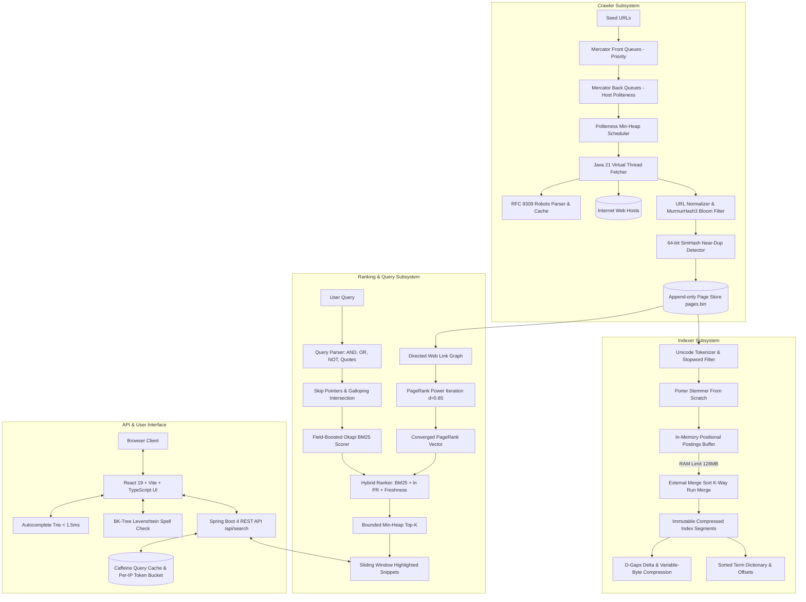
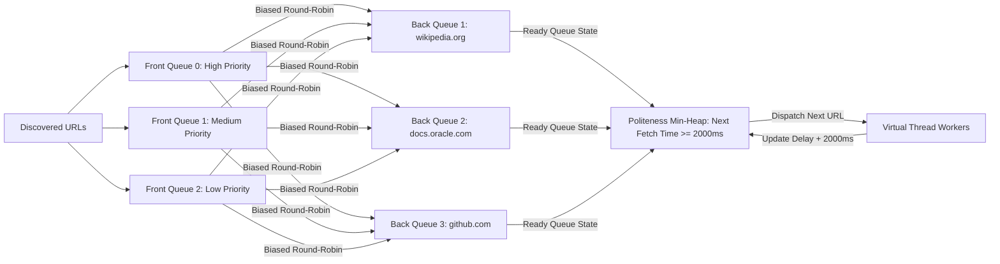
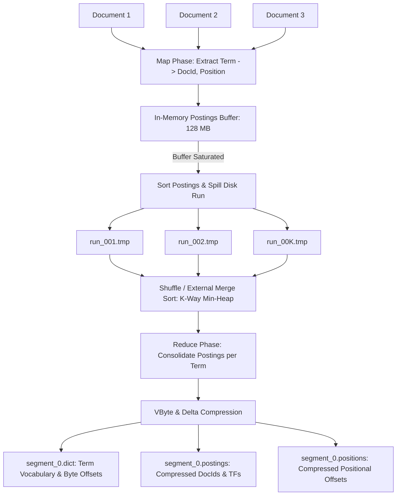

# SearchForge Architecture Specification

## 1. System Overview

SearchForge is a single-node web search engine built in Java 21 and React/TypeScript. It implements the foundational information retrieval and web-scale crawling algorithms pioneered by Google Search infrastructure—written entirely from first principles without relying on third-party search libraries (such as Apache Lucene, Elasticsearch, or Solr).

---

## 2. Mermaid Architecture Diagrams

### 2.1 End-to-End System Flow

### 2.2 Mercator URL Frontier Queue Model

### 2.3 MapReduce Batch Index Construction

---

## 3. Module Boundaries & Responsibilities

| Module | Purpose & Core Contents | External Dependencies |
|---|---|---|
| `sf-core` | Page store, codecs (VByte, Delta), Bloom filter, SimHash, MurmurHash3, URL normalizer, PageRank | SLF4J API only |
| `sf-crawler` | Mercator URL frontier, politeness scheduler, robots.txt parser, virtual thread HTTP fetcher, checkpointing | jsoup (DOM traversal), `sf-core` |
| `sf-indexer` | Unicode tokenizer, stopword filter, Porter stemmer, positional inverted index, external merge sort, index writer/reader, Markdown importer | `sf-core` |
| `sf-query` | Query parser, galloping intersection, BM25F + PageRank prior, top-K heap, autocomplete trie, BK-tree, snippets, relevance metrics | `sf-core`, `sf-indexer` |
| `sf-api` | Spring Boot 4 REST controller, Caffeine cache, per-IP token bucket, security headers, Micrometer metrics | Spring Boot, Caffeine, `sf-query`, `sf-indexer` |
| `sf-bench` | JMH microbenchmarks, 30-query relevance evaluation runner | JMH, `sf-core`, `sf-query` |
| `ui` | React 19, Vite, TypeScript search frontend, plain CSS design tokens | Node 24, Vite |

---

## 4. As built (v1, November 2026)

- PageRank is computed at index time (in `sf-core`, called by the indexer) and stored per
  document in `norms.bin`; the query side only reads it.
- Posting lists are decoded lazily (docIds, then term frequencies, then positions) and
  intersected with galloping search; explicit skip pointers are not stored.
- The frontier keeps one priority queue per host (shallow pages first) plus a min-heap of
  host ready times; it does not have separate Mercator front queues.
- Deployment: one Docker image (UI + API + index) on Render's free plan. See ADR-001.
